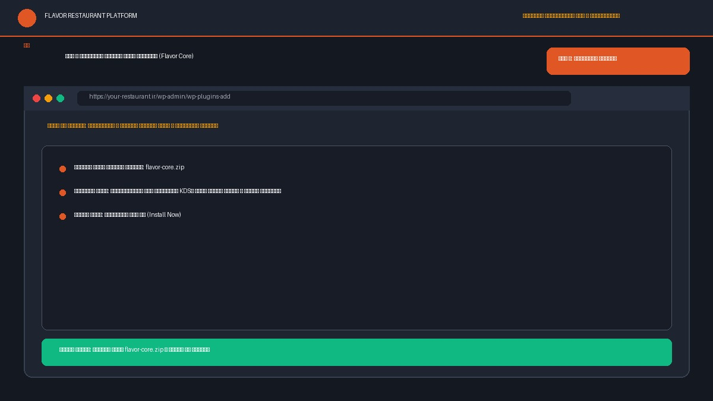
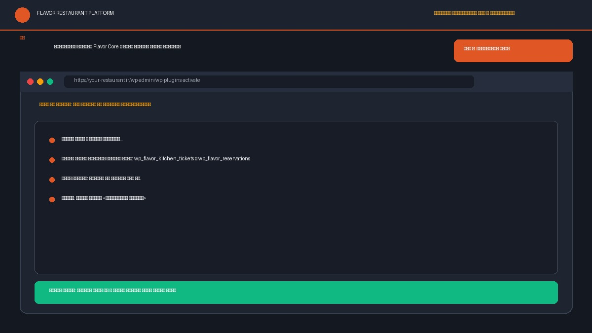
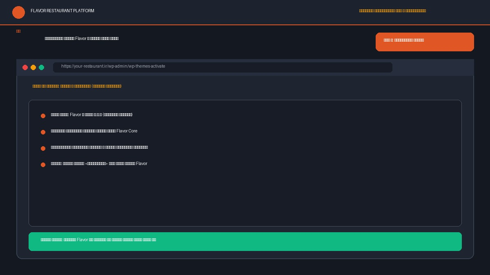
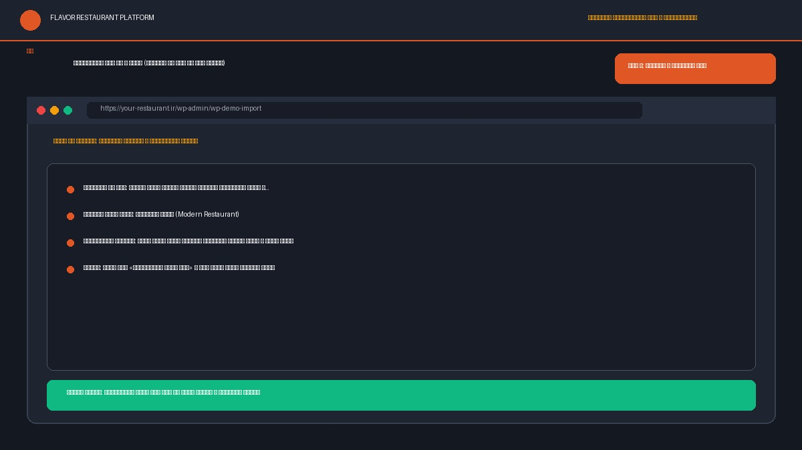
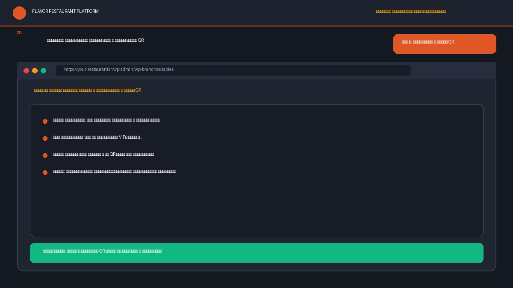
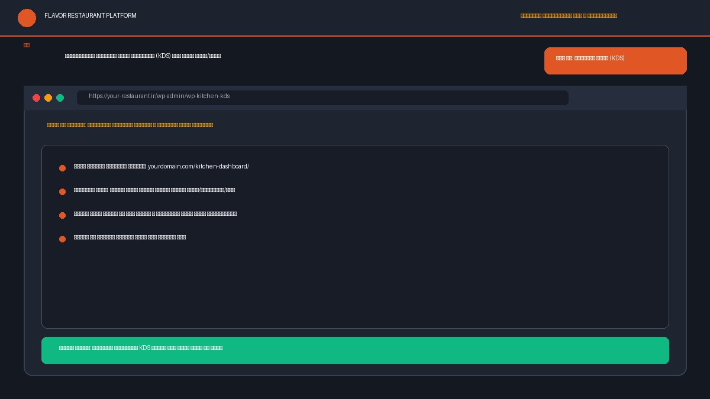
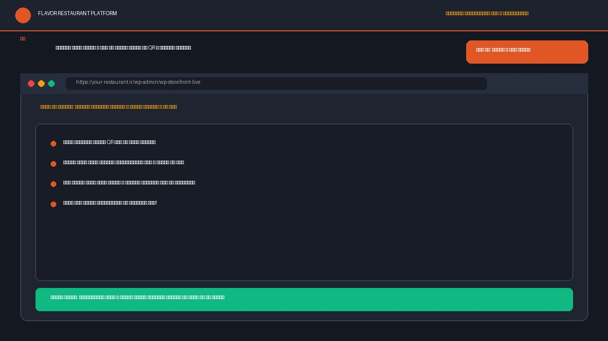

# راهنمای تصویری و اسکرین‌شات‌محور نصب در ۱۲ گام — رستوران مستقیم (Flavor)

این راهنما جایگزین و مکمل ویدیوی نصب (R3-07) بوده و فرایند راه‌اندازی کامل سامانه رستوران مستقیم را از صفر تا تحویل منوی آنلاین و سفارش سر میز در **۱۲ گام تصویری دقیق** با اسکرین‌شات‌های واقعی مستند کرده است. زمان تخمینی اجرای کامل: **۵ تا ۱۰ دقیقه**.

---

## ۱. پیش‌نیازهای میزبانی و هاست

پیش از شروع، مشخصات هاست اشتراکی یا سرور خود را با الزامات زیر تطبیق دهید:

- **نسخه PHP:** نسخه **PHP ۸.۱، ۸.۲، ۸.۳ یا ۸.۴** (پیشنهادی: ۸.۳).
- **ماژول‌های فعال PHP:** ماژول‌های `mbstring`، `curl`، `json`، `openssl`، `zip` و `gd`.
- **تنظیمات پیشنهادی php.ini:**
  - `upload_max_filesize`: دست‌کم `64M`
  - `post_max_size`: دست‌کم `64M`
  - `memory_limit`: دست‌کم `256M` (پیشنهادی `512M`)
  - `max_execution_time`: دست‌کم `120` ثانیه
- **نسخه وردپرس و ووکامرس:** وردپرس ۶.۴ تا ۷.۱+ و ووکامرس ۸.۵ تا ۱۱.۰+ (سازگار با HPOS).

---

## ۲. بسته‌های تحویلی محصول

بستهٔ دانلودی شامل دو فایل اصلی است:
1. **`flavor.zip`**: پوسته اصلی سایت وردپرسی رستوران (سبک، ۱.۳ مگابایت، ۱۰۰٪ راست‌چین).
2. **`flavor-core.zip`**: افزونه اختصاصی هسته عملیات رستوران مستقیم (سفارش آنلاین، آشپزخانه KDS، رزرواسیون میز، پیامک و جداول اختصاصی).

> **توجه مهم:** هرگز فایل ZIP کل پکیج دانلودی را مستقیماً در وردپرس بارگذاری نکنید؛ ابتدا آن را در رایانه خود باز کرده و دو فایل `flavor.zip` و `flavor-core.zip` را استخراج نمایید.

---

## ۳. راهنمای تصویری نصب در ۱۲ گام گام‌به‌گام

### گام ۱: ورود به پیشخوان وردپرس و بررسی منابع هاست
ابتدا به آدرس مدیریت وردپرس خود (`yourdomain.com/wp-admin`) مراجعه کرده و وارد پیشخوان شوید. از منوی ابزارها ← سلامت سایت، از فعال بودن پیش‌نیازهای حافظه و ماژول‌های PHP اطمینان حاصل نمایید.

---

### گام ۲: نصب و بارگذاری افزونه هسته عملیاتی (`flavor-core.zip`)
به مسیر **افزونه‌ها ← افزودن** (افزودن افزونه تازه) بروید. روی دکمهٔ **بارگذاری افزونه** در بالای صفحه کلیک کنید. فایل فشردهٔ `flavor-core.zip` را انتخاب کرده و روی **هم‌اکنون نصب کن** کلیک نمایید.

---

### گام ۳: فعال‌سازی افزونه Flavor Core و ساخت خودکار جداول
پس از بارگذاری موفق، روی دکمهٔ **فعال‌کردن افزونه** کلیک کنید. در این مرحله افزونه جداول سفارشی و پرسرعت پایگاه داده مانند `wp_flavor_kitchen_tickets` و `wp_flavor_reservations` را به‌صورت خودکار ایجاد می‌کند.

---

### گام ۴: نصب خودکار یا فعال‌سازی ووکامرس (WooCommerce) و HPOS
سامانه به ووکامرس ۸.۵+ متصل می‌شود. در صورتی که ووکامرس قبلاً نصب نشده باشد، افزونه اقدام به **نصب WooCommerce** و فعال‌سازی خودکار آن می‌نماید. از مسیر **ووکامرس ← پیکربندی ← پیشرفته ← امکانات** مطمئن شوید قابلیت ذخیره‌سازی سفارش با کارایی بالا یا همان **HPOS** فعال است. همچنین برای روش‌های پرداخت به مسیر **ووکامرس ← پیکربندی ← پرداخت‌ها** بروید.

---

### گام ۵: نصب و بارگذاری پوسته اصلی (`flavor.zip`)
به مسیر **نمایش ← پوسته‌ها** (افزودن پوسته تازه) مراجعه کنید. روی **بارگذاری پوسته** کلیک کرده و فایل سبک `flavor.zip` (با حجم حدود ۱.۳ مگابایت) را انتخاب و روی دکمهٔ **هم‌اکنون نصب کن** کلیک کنید.

---

### گام ۶: فعال‌سازی پوسته Flavor و بررسی پیوند با افزونه
روی دکمهٔ **فعال‌کردن** قالب Flavor کلیک کنید. قالب بلافاصله با افزونه هسته پیوند برقرار کرده و بدون نیاز به کدهای اضافه آماده تنظیمات اولیه می‌شود.

---

### گام ۷: تنظیم ساختار پیوندهای یکتا روی حالت «نام نوشته» (حیاتی)
به مسیر **تنظیمات ← پیوندهای یکتا** بروید و ساختار را روی **نام نوشته** (`/%postname%/`) قرار داده و ذخیره کنید. این گام برای کارکرد صحیح مسیرهای REST API، سفارش سر میز و کدهای QR الزامی و حیاتی است.

---

### گام ۸: درون‌ریزی دمو با ۱ کلیک (انتخاب از بین ۱۲ سبک تخصصی)
به مسیر **نمایش ← دموهای Flavor** (یا رستوران مستقیم ← درون‌ریزی دموها) بروید. یکی از ۱۲ دموی آماده (مانند رستوران مدرن، سنتی اصیل، فست‌فود، کافه بیسترو، پیتزا یا لوکس) را انتخاب کرده و دکمهٔ **درون‌ریزی دمو** را بزنید تا تمام محصولات، منوها، دسته‌بندی‌ها و تنظیمات ظاهر در کمتر از ۱ دقیقه درج شوند.

---

### گام ۹: پیکربندی شعبه و تعریف میزهای سالن و بارکدهای QR
در منوی **رستوران مستقیم ← تنظیمات** ساعات کاری و اطلاعات پایه شعبه را تنظیم کرده و سپس به بخش **رستوران مستقیم ← میزها و QR** بروید تا میزهای سالن رستوران خود را تعریف کنید. برای هر میز یک توکن یکتا و کد QR با قابلیت چاپ فوری تولید می‌شود که می‌توانید آن را دانلود و روی استند میزها نصب کنید.

---

### گام ۱۰: تنظیم درگاه پیامک ایرانی جهت ورود و احراز هویت OTP
به بخش **رستوران مستقیم ← تنظیمات** (زبانه پیامک) بروید. پنل پیامک خود (کاوه‌نگار، فراز اس‌ام‌اس، ملی‌پیامک یا قاصدک) را انتخاب کرده و کلید API را وارد نمایید تا ورود مهمانان بدون رمز عبور و با پیامک کد تایید انجام پذیرد.

---

### گام ۱۱: راه‌اندازی داشبورد لمسی آشپزخانه (KDS) روی تبلت سالن/مطبخ
تبلت یا مانیتور آشپزخانه را باز کرده و به آدرس مسیر زندهٔ `/kitchen-dashboard/` بروید. این داشبورد با کلیدهای لمسی بزرگ ۴۸ پیکسلی، آلارم صوتی سفارش جدید و چاپ خودکار فیش، سفارش‌های سالن و پیک را بلافاصله نمایش می‌دهد.

---

### گام ۱۲: مشاهده سایت نهایی و تست یک سفارش واقعی با QR
مسیر منوی دیجیتال در `/menu/` و پیگیری سفارش‌ها در `/order-tracking/` در دسترس است. کد QR یکی از میزها را با گوشی هوشمند خود اسکن کنید. منوی رستوران بدون معطلی باز می‌شود، غذای دلخواه با مخلفات را انتخاب کرده و سفارش را ثبت کنید. فیش سفارش بلافاصله روی نمایشگر آشپزخانه ظاهر می‌شود. راه‌اندازی با موفقیت به پایان رسید!

---

## ۴. عیب‌یابی و خطاهای رایج هاست اشتراکی

در هاست‌های اشتراکی در صورت بروز خطاهای متداول زیر، راهکارهای مقابل را اعمال نمایید:

1. **خطای The uploaded file exceeds the upload_max_filesize directive in php.ini:**
   - هاست شما اجازه بارگذاری فایل‌های بالای ۲ مگابایت را نمی‌دهد. در کنترل پنل هاست مقدار `upload_max_filesize` و `post_max_size` را به `64M` افزایش دهید.
2. **خطای کمبود حافظه یا Allowed memory size exhausted:**
   - مقدار ثابت `WP_MEMORY_LIMIT` را در فایل `wp-config.php` به صورت `define('WP_MEMORY_LIMIT', '256M');` تنظیم نمایید.
3. **خطای ۴۰۴ در مسیرهای منو یا روت‌های API:**
   - مجدداً به مسیر **تنظیمات ← پیوندهای یکتا** رفته و یک بار دکمهٔ «ذخیره تغییرات» را بفشارید تا فایل `.htaccess` بازنویسی شود.
